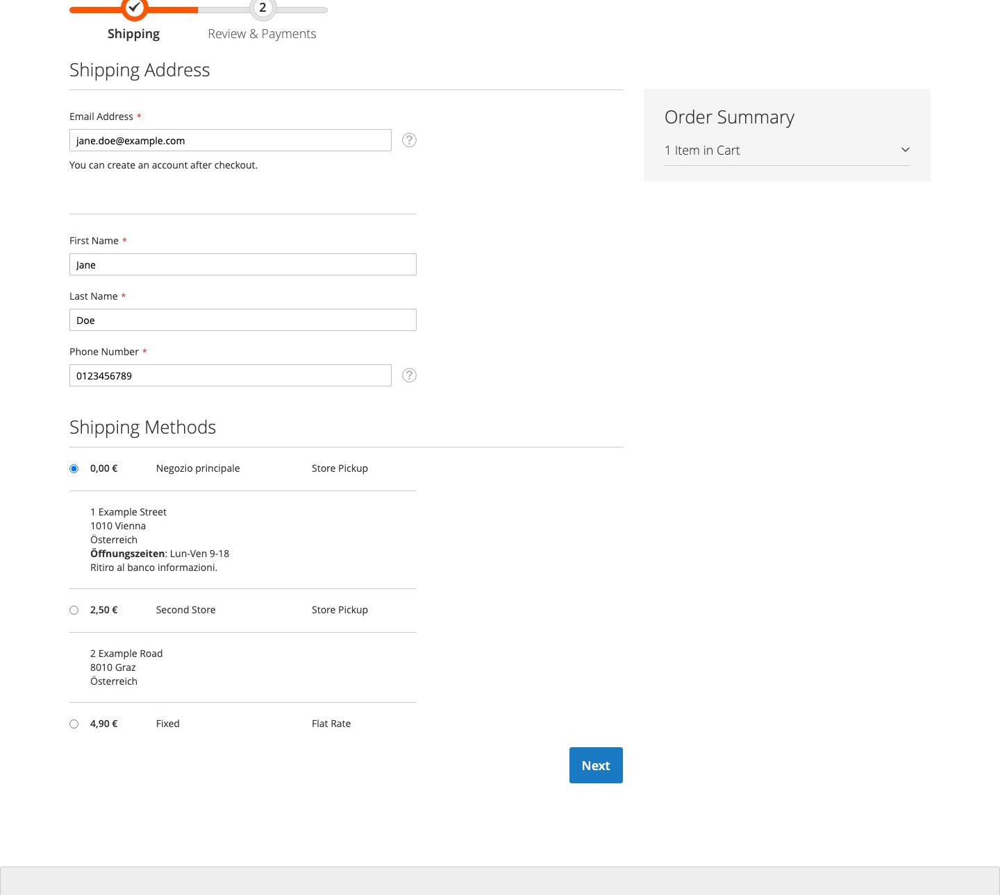
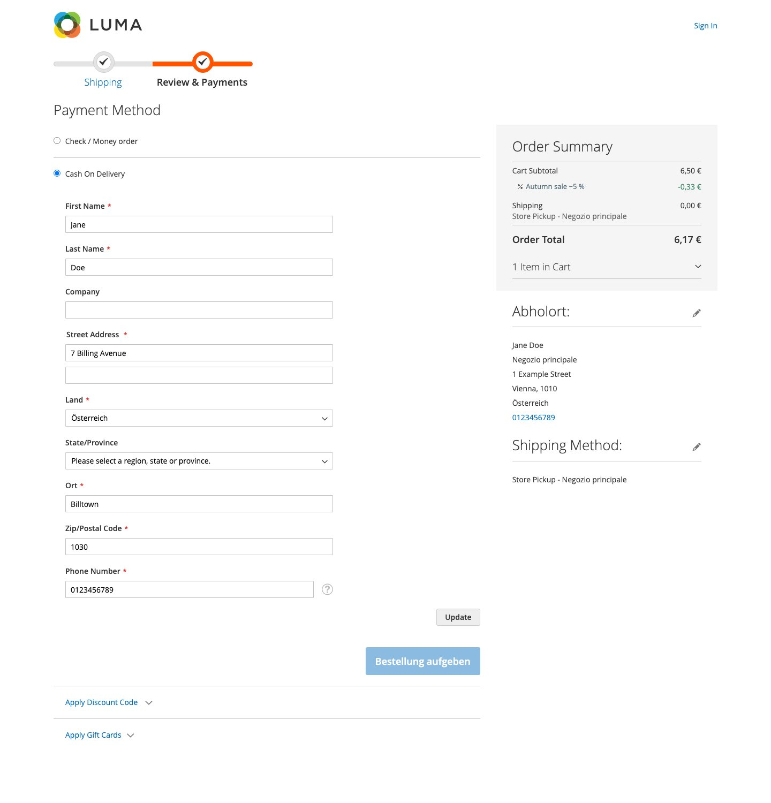
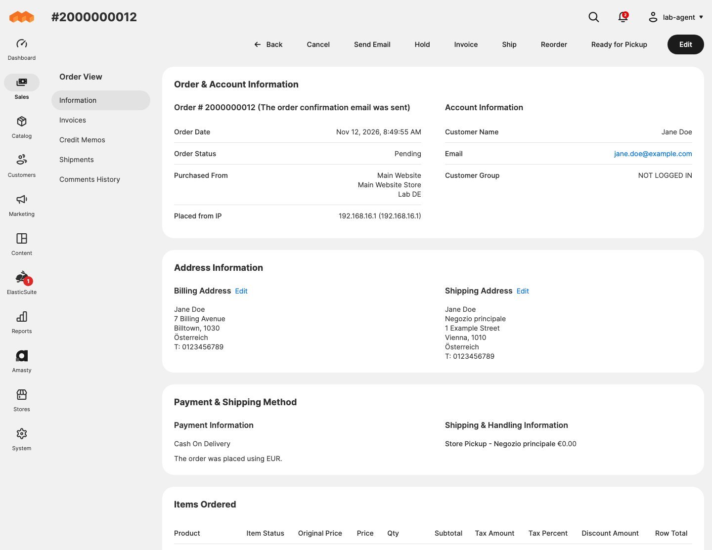

# Store Pickup for the Luma Checkout

Luma checkout companion for
[`pixelperfectat/magento2-module-store-pickup`](https://github.com/pixelperfectat/magento2-module-store-pickup).
It shows the chosen pickup location in place of the shipping address form, the location details under each pickup
rate, and keeps the billing address separate.



- Selecting a pickup rate fills the shipping address from the location and hides the address fields. First name, last
  name and phone stay.
- Customers with saved addresses see a small contact form instead of the address list.
- Each pickup rate shows the location details beneath it.
- Billing is entered or picked on the payment step; it never copies the location.
- The sidebar shows "Pickup Location" in place of "Ship To".

## Requirements

- PHP `^8.3`
- `pixelperfectat/magento2-module-store-pickup` `^0.1`
- Magento Open Source or Mage-OS with the native Luma checkout (Knockout and RequireJS), rendered by a Luma-based
  theme on the store view. This was verified in the lab with `Magento/luma` on the store view. Setting
  `hyva_themes_checkout/general/checkout` to `magento_luma` alone is not enough: on a Hyvä theme it shows "No
  Checkout module installed". Hyvä's separate Luma theme fallback for the checkout route may work but is untested.
  For Hyvä Checkout itself use the Hyvä companion module.

## Installation

```bash
composer require pixelperfectat/magento2-module-store-pickup-luma
bin/magento setup:upgrade
```

## Configuration

There is no configuration of its own. Pickup locations, texts and payment rules are configured in the core module; see
its [README](https://github.com/pixelperfectat/magento2-module-store-pickup#configuration).

## What it changes

| What | Where |
|---|---|
| Location data | Config provider `PickupConfigProvider` adds `window.checkoutConfig.ppStorePickup` with `carrierCode` and `locations`. `locations` is keyed by location code and holds `code`, `name`, `street`, `postcode`, `city`, `countryId`, `regionId`, `region`, `telephone`, `openingHours`, `note` and `addressLines`. If the locations cannot be read, it ships an empty list and logs the error, so the checkout stays usable. |
| Shipping step | Mixin on `Magento_Checkout/js/view/shipping`. For a pickup rate, see below. |
| Saved-address list | Mixin on `Magento_Checkout/js/view/shipping-address/list`. It makes the list's `visible` an observable, so the shipping mixin can hide the list and show it again on switching back. |
| Contact form | Template `shipping-address/pickup-contact.html`, added by the shipping mixin for customers with saved addresses. Luma has no form for a new address in that case, and a saved address cannot carry the name and phone of the person who collects the order. |
| Billing step | Mixin on `Magento_Checkout/js/view/billing-address`. The "billing and shipping address are the same" checkbox is hidden for pickup rates, and a billing address that equals the location is dropped, so billing (with phone) is required. |
| Details under each rate | Template override `shipping-address/shipping-method-item.html`, set through `shippingMethodItemTemplate` in `checkout_index_index.xml`. |
| Sidebar | Mixin on `Magento_Checkout/js/view/shipping-information` and template `shipping-information.html` show "Pickup Location" in place of "Ship To". |

All mixins are registered in `view/frontend/requirejs-config.js`; the shared model is `js/model/pickup.js`.

**Guests and customers without saved addresses** use the inline form. While a pickup rate is selected, country,
region, street, postcode, city and company (the location name) are filled from the location and hidden. First name,
last name and phone stay visible and required, because Luma collects billing only on the payment step.

**Customers with saved addresses** do not see the address list and the "New Address" button. A small contact form
(first name, last name, phone) feeds a new address built from the location. Switching back to a delivery rate
re-selects the address that was selected before.



## Restoring the typed address

Switching back to a delivery rate puts the typed address back. The values are kept client-side:

- The typed address is stored in the extra key `ppTypedShippingAddress` of Magento's `checkout-data` section
  (customer-data, `mage-cache-storage`), per store view like Luma's own address data, together with the location
  address that was written into the form.
- The key is cleared on restore, on order placement and on login and logout, as Magento clears the section.
- Once on page load the module checks whether the form still holds the written location address. If so, the typed
  values go back in. This also works when the location was deactivated in the meantime. Without stored values, the
  inline form (guests and logged-in customers without saved addresses) is cleared of an active location's address.

The server does not depend on this: the core plugin rewrites the posted address to the location anyway. The address
book is never written; the location address is posted with `save_in_address_book` set to 0.

## Customising

Override the templates in your theme, under the same module path:

- `PixelPerfect_StorePickupLuma/template/shipping-address/shipping-method-item.html` (rate row with the details row)
- `PixelPerfect_StorePickupLuma/template/shipping-address/pickup-contact.html` (contact form)
- `PixelPerfect_StorePickupLuma/template/shipping-information.html` (sidebar)

The layout is in `view/frontend/layout/checkout_index_index.xml`.

Translations are included for `en_US`, `de_DE` and `it_IT`.

## Known limits

- A theme that replaces the shipping step, the `shipping-method-item` or the `shipping-information` template, or the
  address list, has to re-apply the changes in its own copy.
- Clicking the details row does not select the rate; the radio button and the rate row do.
- If a pickup-only payment method is configured and the chosen location is deactivated mid-checkout, the order is
  refused with the payment-method error rather than the shipping-method error.
- Location texts are resolved for the page's store view. A store view that shares the base URL with another one must
  be selected through the store switcher (store cookie), as usual in Magento.

The placed order carries the pickup location, as described in the core README.



## License

MIT, see [LICENSE](LICENSE).
